<div align="center">



<br />

<a href="https://github.com/Zweilior"></a>


</div>

<br />

## Hello, World

```js
const riff = {
  name: "Muhammad Arif Saputra",
  nickname: "Riff",
  campus: "Institut Teknologi Kalimantan (ITK)",
  major: "Information Systems",
  interests: ["Backend", "Databases", "Data Visualization"],
  currentlyLearning: ["Laravel", "Power BI", "Clean Code"],
  motto: "Build it. Break it. Debug it. Improve it.",
};
```

- 🎓 Mahasiswa Sistem Informasi di **ITK**
- 🔨 Selalu Belajar Mencoba Teknologi Baru
- 📊 Tertarik pada **backend, database, dan visualisasi data**
- 🌱 Konsisten naik level, satu commit per hari

---

## 🧰 Tech Stack

<div align="center">


<br /><br />


</div>

---

## 📈 GitHub Stats

<div align="center">


<br />

<!--  -->

</div>

---

## 🔁 Dev Loop

<div align="center">

```
learn() → build() → debug() → improve() → repeat()
```

**Makasih sudah mampir!** Silakan jelajahi repository-ku dan ikuti perjalanan belajarku. 🚀


</div>


